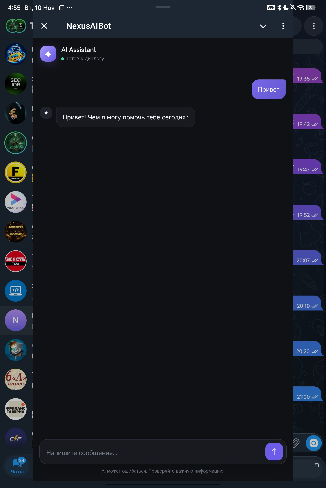

# 🤖 AI Assistant — Telegram Mini App

Полноценный AI-ассистент внутри Telegram с удобным чат-интерфейсом в стиле современных нейросетей.

## Функционал:
- Красивый и адаптивный чат-интерфейс (Mini App) с анимацией набора текста.
- Асинхронный бэкенд на Python (aiogram 3 + aiohttp).
- Интеграция с API **Google Gemini** (используется модель `gemini-3.5-flash`).
- Настроен CORS для безопасного взаимодействия между фронтендом (GitHub Pages) и бэкендом (Railway).
- Обработка таймаутов и перегрузок серверов Google (защита от ошибок 503).

## Технологии:
- **Frontend:** HTML, CSS, JavaScript (Telegram WebApp API)
- **Backend:** Python (aiogram, aiohttp, google-genai)
- **AI:** Google Gemini API
- **Деплой:** GitHub Pages (Frontend), Railway (Backend)

## Скриншоты:

